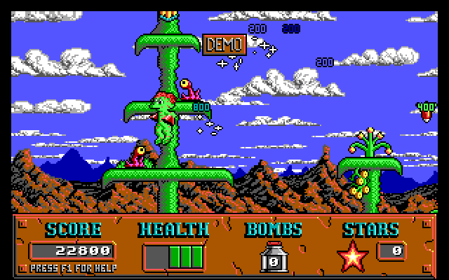

# Cosmo Enhanced

Play *Cosmo's Cosmic Adventure* on Windows and Android with optional widescreen, smoother scrolling and animations, and modern controls.

**[Download the latest release](https://github.com/GITitdoneboi/enhanced-cosmo/releases/latest)**

## Download and play

- **Windows x64** — Extract the ZIP and launch `cosmo.exe`. If you own Episodes 2 and 3, select each episode in the launcher and locate its game files when prompted.
- **Android** — Install the APK on an ARM64 or x86-64 device. Touch controls are enabled by default and built into the launcher and gameplay HUD. Keyboards and gamepads also work.

Both downloads include the shareware first episode, *Forbidden Planet*.

## Controls and settings

- **Keyboard** — Use the arrow keys to move, **Space** to jump, and **Alt** to throw a bomb. Change bindings under **Game Settings → Keyboard Mapping**.
- **Gamepad** — Play and navigate menus with a controller. See **Game Settings → Gamepad Controls** for the button layout. Rumble is available on supported controllers.
- **Android touch** — Use the HUD buttons during play and **Select** and **Back** in menus. The Android system Back button acts as Escape. Use the device keyboard to enter your name on the high-score screen. To turn touch controls off, use **Customise → Touch Controls**.

Use **Game Settings** to adjust music and sound effects volumes separately or change the display filter.

## Customise

Open **Customise** in the episode launcher to choose how the game looks and sounds.

- Choose the original view or enable **Widescreen** for a wider playfield.
- Enable **Smooth Gameplay** for smoother scrolling, character movement, and animations. It starts enabled on fresh Android installs.
- Switch between the original and remixed Episode 1 soundtrack, or between original and softened sound effects.
- Choose CRT effects, scanlines, both, or neither.
- Preview and change Cosmo's body and accent colours under **Character Colour**.

## Credits and project links

Cosmo Enhanced builds on Scott Smitelli's [Cosmore](https://github.com/smitelli/cosmore). The original game was released by Apogee Software in 1992. See [full credits](ATTRIBUTION.md) and the [source code license](LICENSE).

[Release notes](https://github.com/GITitdoneboi/enhanced-cosmo/releases) · [Android build guide](android/README.md) · [Modding guide](docs/modding.md) · [Porting notes](docs/porting-notes.md)
